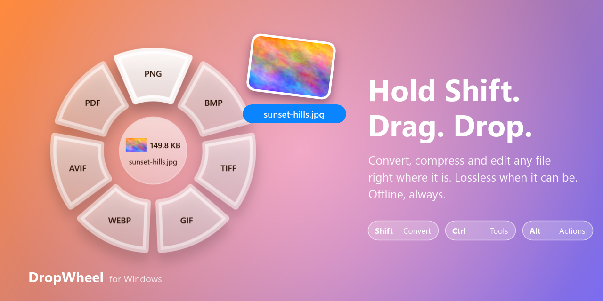

<div align="center">

# DropWheel

**Hold a key while you drag a file. A wheel appears. Let go on what you want.**

Convert, compress, crop, merge, protect: 70+ file jobs for Windows, done where the file already is,
with no upload, no account and no window to open.



</div>

---

## The idea

Most file tools make you go to them: open an app or a website, upload, pick options, download, find the
result. DropWheel goes to the file. You are already dragging it. Press a key mid-drag and the job becomes
the drop target.

| You hold | You get | For example |
| --- | --- | --- |
| **Shift** | the **Convert** wheel | PNG → WebP, HEIC → JPG, MOV → MP4, DOCX → PDF |
| **Ctrl** | the **Tools** wheel | compress, resize, crop, rotate, watermark, merge, protect |
| **Alt** | the **Actions** wheel | copy path, copy or move to…, open terminal here, float on top |

No key, no wheel: a normal drag stays a normal drag. Keys can be changed in Settings, and **Ctrl+Alt+T**
opens the same wheels for whatever is selected in Explorer, without dragging.

## What makes it different

**It does not touch pixels it does not have to.** "Compress" means lossless here: the JPG, PNG, GIF and
SVG it writes decode to exactly the same pixels as the original. That is checked, not promised. The
self-test compares every pixel and fails on a single difference. JPG crops and rotations are done on the
compressed data without re-encoding (four right turns give back a byte-identical picture). A JPG put into
a PDF goes in byte for byte. Page numbers and watermarks are laid over a PDF's pages instead of
rewriting them. When a job cannot be lossless (resizing, "compress to 200 KB", converting to a lossy
format), it says so in its description and only runs when you pick it.

**It asks one question, never a dialog.** Tools that need a value ask for it in plain words, and check it
before anything runs:

```
Resize          1920x1080 · 800 · x600 · 50% · 2x · 6x4in@300dpi
Compress to…    200 KB · 1.5 MB · 70%
Crop            16:9 · 800x600 · 10,20,800,600
Split PDF       all · 1-3, 4-6, 7-z
Organize PDF    3, 1, 2, 5-z        (pages left out are removed)
Protect PDF     ••••••••            (masked; passed to the engine by file, never on a command line)
```

**It is offline by construction.** There is no network code in the app. Everything runs on open-source
engines that ship next to the exe.

## Everything it does

<details open>
<summary><b>Pictures</b> · Ctrl-drag groups them like a photo toolbox: Optimize, Edit, Create</summary>

| | |
| --- | --- |
| **Optimize** | Compress (lossless JPG/PNG/GIF/SVG) · Compress to a size or quality · Strip EXIF and location (pixels untouched) |
| **Edit** | Resize and enlarge (exact, one side, %, print size) · Crop (ratio, centre, exact) · Rotate left / right |
| **Create** | Watermark text · Meme captions · To PDF (one or many pictures) |
| **Convert** | JPG PNG BMP TIFF GIF WebP AVIF PDF, animated GIF from several pictures; reads HEIC, SVG, PSD and camera RAW (CR2 CR3 NEF ARW DNG RAF ORF RW2) |
| **Web pages** | drop an `.html` file or a `.url` shortcut → full-page PNG/JPG or PDF |
</details>

<details open>
<summary><b>PDF</b> · grouped as Organize, Optimize, Edit, Security</summary>

| | |
| --- | --- |
| **Organize** | Merge · Split (every page or ranges) · Organize (reorder / delete) · Rotate left / right |
| **Optimize** | Compress (lossless) · Compress more (low / medium / strong; text stays text) · Repair |
| **Edit** | Page numbers · Watermark · Crop margins (lossless crop box) · Redact words |
| **Security** | Unlock · Protect with AES-256 · Strip metadata |
| **Convert** | JPG / PNG pages at 200 dpi · extract the pictures inside, unchanged · text · Markdown · PDF/A-2b · Word · PowerPoint · Excel tables |
</details>

<details>
<summary><b>Video, audio, documents, archives</b></summary>

| | |
| --- | --- |
| **Video** | MP4 MOV MKV WebM AVI WMV GIF · extract audio · resize · compress to a target size |
| **Audio** | MP3 M4A WAV FLAC OGG Opus AIFF WMA · compress to a target size |
| **Office** | Word, PowerPoint, Excel ↔ PDF · DOCX/ODT/RTF · XLSX/ODS/CSV/TSV · slides to pictures |
| **Subtitles** | SRT ↔ VTT · plain text |
| **Archives** | ZIP · TAR · TAR.GZ · unpack RAR and 7z |
</details>

<details>
<summary><b>Actions</b> (Alt) · these never change the file</summary>

Copy path · Copy to… · Move to… · Open a terminal here · Show in folder · Float the file in a small
always-on-top tile you can drag back out later.
</details>

## The engines

DropWheel is a thin, careful front end. The heavy lifting is done by projects that have earned trust over
decades. `app/fetch-engines.ps1` downloads pinned releases from each project's official page, checks
every file against its SHA-256, and unpacks them into `app/DropWheel/engines/`. Nothing gets installed
and nothing touches the registry.

| Engine | Version | Does | License |
| --- | --- | --- | --- |
| [ImageMagick](https://imagemagick.org) | 7.1.2-34 | decoding, conversion, crop, captions | ImageMagick (Apache-style) |
| [oxipng](https://github.com/oxipng/oxipng) | 10.2.1 | lossless PNG | MIT |
| [libjpeg-turbo](https://libjpeg-turbo.org) (jpegtran) | 3.2.0 | lossless JPG optimise, crop, rotate | IJG / BSD |
| [gifsicle](https://www.lcdf.org/gifsicle/) | 1.97 | lossless GIF | GPL-2.0 |
| [qpdf](https://qpdf.sourceforge.io) | 12.4.2 | lossless PDF rewriting, encryption | Apache-2.0 |
| [Ghostscript](https://ghostscript.com) | 10.08.0 | PDF rendering, PDF/A, strong compression | AGPL-3.0 |
| [LibreOffice](https://www.libreoffice.org) | 26.8.1 | Office ↔ PDF | MPL-2.0 |
| [PdfPig](https://github.com/UglyToad/PdfPig) | 0.1.16 | PDF reading, text, overlays (in-process) | Apache-2.0 |
| [ffmpeg](https://ffmpeg.org) | from PATH | video and audio | LGPL/GPL |
| Microsoft Edge | with Windows | HTML to image / PDF | (system) |

The image and PDF engines come to 68 MB. A tool whose engine is missing simply doesn't appear on the
wheel, and Settings lists what an engine would add.

> If you ever distribute DropWheel with these engines, their licenses travel with them. Ghostscript is
> AGPL and gifsicle is GPL. They run as separate programs, but you must ship their notices and offer
> their source.

## Build and run

Windows 10/11, .NET 10 SDK, 7-Zip (only for fetching engines).

```powershell
pwsh app/fetch-engines.ps1                                  # once: download and verify the engines
dotnet build app/DropWheel -c Release
app/DropWheel/bin/Release/net10.0-windows10.0.19041.0/DropWheel.exe
```

It lives in the tray. Right-click the tray icon for Settings (trigger keys, output folder, start with Windows) and Pause.

## How it knows what you're dragging

A drag's contents can't be read until it is dropped, so DropWheel doesn't try. A low-level mouse hook
notices a drag that starts in Explorer or on the desktop. A keyboard hook watches for the trigger key, so
pressing Shift while the mouse is still opens the wheel at once. The file comes from Explorer's own
selection (Shell automation, then UI Automation for the item under the cursor). The wheel is a
non-activating window, so it never steals focus and never cancels your drag. Each wedge is a real drop
target.

```
mouse hook ── drag began in Explorer? ──┐
keyboard hook ── Shift / Ctrl / Alt ────┼──▶ wheel under the cursor ──▶ drop on a wedge ──▶ job queue ──▶ engine
Explorer selection ── which files ──────┘                                (one question?)    (parallel,      (outside
                                                                                              cancellable)   the app)
```

Outputs land beside the original as `photo-compressed.png`, `photo (1).jpg` and so on. Nothing is ever
overwritten, and a job that fails leaves nothing behind.

## Proof it works

```powershell
DropWheel.exe --selftest log.txt                 # 130+ checks against real files
pwsh e2e/drag.ps1 -Key Ctrl -Group 1 -Slots 4 -SlotIndex 1 -Expect pic-cropped.png
```

The self-test builds real inputs (photos, PDFs with text and pictures, documents, clips) and runs every
tool through the same code the wheel uses. It checks the results the hard way: pixel-by-pixel comparison
for lossless claims, `ffprobe` for media, page text and picture bytes for PDFs, a truncated PDF that has
to come back passing `qpdf --check`, and a password that really has to lock and unlock. The e2e scripts
move the real mouse in a real Explorer window and answer prompts through UI Automation, like a person
would.

## Roadmap

- [x] Phase 1: picture tools, all lossless where possible
- [x] Phase 2: PDF tools on qpdf and Ghostscript
- [ ] Phase 3: Office ↔ PDF on bundled LibreOffice (code written; bundled engine not yet fetched or tested)
- [ ] Phase 4: local AI: upscale (Real-ESRGAN), remove background (U²-Net), blur faces, OCR (Tesseract)
- [ ] Bundle ffmpeg the same way as the other engines
- [ ] An installer (`app/install.ps1` is drafted)

## Repository map

```
app/DropWheel/      the WPF app: hooks, wheel, job queue, tools, self-test
app/fetch-engines.ps1   pinned, hash-checked engine downloads
e2e/                real-mouse drag tests and prompt answering
replica/            the design notes: recon, architecture, design tokens, feature matrix, bugs, build log
```

<div align="center">
<sub>Built for personal use. Everything runs on your machine.</sub>
</div>
